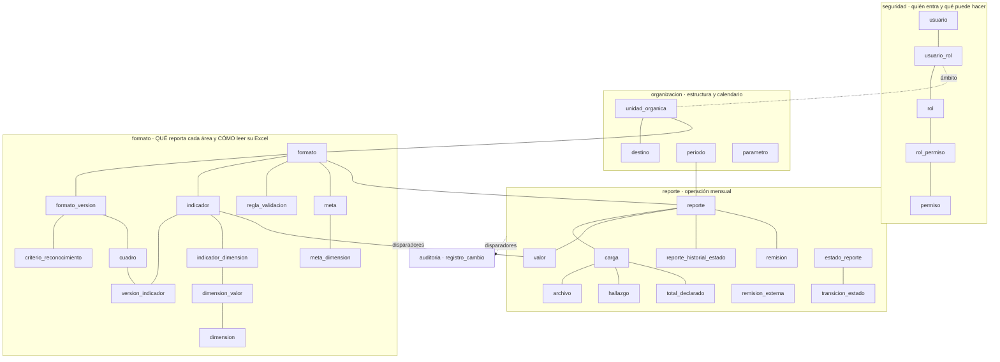

# Avance 04 · Modelo general de la base de datos

**Sistema de Reporte Estadístico · Hospital Regional de Loreto**
**Fecha:** 26 de septiembre de 2026
**Base:** avance 03 + respuestas a los pendientes de los avances 01, 02 y 03
**Motor:** PostgreSQL (probado en la versión 16) · **Backend:** FastAPI · **Bot:** Node

Este avance deja la BD **general**, sin depender de datos de Nutrición que no están confirmados. Es el documento de referencia del modelo vigente. El detalle tabla por tabla sigue en el `INFORME_AVANCE_02.md`, con los cambios de lectura del `INFORME_AVANCE_03.md`. Aquí se resumen ambos.

---

## 1. Respuestas recibidas y qué se hizo

| Avance | Pendiente | Respuesta | Cambio en la BD |
|---|---|---|---|
| 03 | 1. Excel real de Nutrición | No hay por ahora | Ninguno: `NUT-1` sigue **en configuración** |
| 03 | 2. ¿Quién configura las lecturas? | **También Estadística** | Nuevo permiso `formato.configurar_lectura`, asignado al `revisor` (§ 2.2) |
| 03 | 3. ¿Dónde vive el lector? | En el **bot de Node**, que se adaptará | Nueva vista `formato.v_configuracion_lectura`: el JSON que FastAPI le entrega al bot (§ 2.4) |
| 02 | 1. 7 FK de proceso hacia `usuario` | Se mantienen | Ninguno |
| 02 | 2. Re-subida reemplaza también las correcciones manuales | Ok | Ninguno en la estructura. Se documenta la transacción (§ 4) |
| 02 | 3. Almacenamiento de archivos | **Disco del servidor** | Parámetro `archivo.almacenamiento = disco_servidor` |
| 02 | 4. Bitácora de lo que carga el bot | **No fila por fila; lo más óptimo** | Auditoría **resumida por carga** (§ 2.3) |
| 01 | 1. Financiador | Usar `dimension_valor` | Ya estaba así. La dimensión existe **sin valores**; se agregan cuando se confirmen |
| 01 | 2. «Comida» | Solo hay desayuno, almuerzo y cena | Se quitó la nota sobre «comida» |
| 01 | 3. El oficio | **Es un ejemplo, no es real** | El catálogo que salía de él **ya no se instala**: pasa a `07_ejemplo_nutricion.sql` (§ 2.1) |
| 01 | 4. Meta anual | No hay información | Ninguno: `formato.meta` queda lista, sin datos |
| 01 | 5. Datos crudos | No hay | Ninguno |

---

## 2. Cambios de este avance

### 2.1 La instalación ya no trae datos de ejemplo

Hasta el avance 03, la semilla cargaba cuatro cuadros, 36 indicadores y los grupos de comensales y de dietas sacados del oficio N.º 122-2026. Como ese oficio es un **ejemplo**, ese catálogo no debe instalarse como si fuera real.

| Qué | Dónde queda ahora |
|---|---|
| Núcleo: roles, permisos, estados, transiciones, unidades, matriz, periodos 2026, parámetros | `04_semilla.sql` (se instala) |
| Formato `NUT` (granularidad diaria, confirmada) y versión `NUT-1` en configuración | `04_semilla.sql` (se instala) |
| Reglas de validación del bot | `04_semilla.sql` (se instala) |
| Dimensiones con valores **confirmados**: comida (desayuno, almuerzo, cena), población (comensales, pacientes) y servicio (hospitalización, emergencia), estas dos según la ficha final de Estadística | `04_semilla.sql` (se instala) |
| Dimensión `financiador` | `04_semilla.sql`, **sin valores** |
| Cuadros, 36 indicadores, grupos de comensales, tipos de dieta, financiador SIS | `07_ejemplo_nutricion.sql`, **no se instala**. Solo lo usa la prueba, y lo deshace |

**Queda por confirmar:** la matriz marca Nutrición → Planeamiento como entrega inmediata. Ese dato también salía del oficio de ejemplo. Se mantiene, pero anotado como "por confirmar" en `organizacion.destino.observacion`.

### 2.2 Estadística configura lecturas

| Permiso | Qué permite | Roles |
|---|---|---|
| `formato.gestionar` | El catálogo: formatos, indicadores, dimensiones, reglas y metas | superadmin |
| `formato.configurar_lectura` **(nuevo)** | Crear versiones de estructura, criterios de reconocimiento, hojas y ubicaciones; activar y retirar versiones | superadmin, **revisor** |

Son dos permisos separados para que Estadística pueda resolver al momento el caso "el área cambió su Excel" sin tener acceso a modificar el catálogo de indicadores.

### 2.3 Bitácora: la carga del bot se resume

**Antes**, cada casilla que guardaba el bot generaba una fila en la bitácora (1 080 por mes en Nutrición, el doble con cada re-subida).

**Ahora**, durante la transacción de una carga, el backend fija:

```sql
SELECT set_config('app.carga_id', '<id de la carga>', true);
```

Mientras ese valor esté fijado, los `INSERT` y `DELETE` sobre `reporte.valor`, `reporte.total_declarado` y `reporte.hallazgo` **no se registran fila por fila**. Dos disparadores por sentencia, que usan tablas de transición, escriben **una sola fila resumen** por tabla y operación:

| tabla | operacion | registro_id | datos |
|---|---|---|---|
| valor | `INSERTAR_MASIVO` | *id de la carga* | `{"carga_id": 2, "filas": 1080}` |
| hallazgo | `INSERTAR_MASIVO` | *id de la carga* | `{"carga_id": 2, "filas": 1}` |

**Qué sigue registrándose fila por fila** (fuera de una carga):
- las correcciones manuales de casillas;
- las justificaciones;
- los cambios de estado;
- y todo lo demás.

**Por qué no se pierde trazabilidad:** el detalle de lo que cargó el bot está en el **archivo guardado** (con su huella SHA-256) y en la `carga`, con el informe completo del bot. Cualquier cifra se puede rastrear a su celda con `valor.hoja_excel` y `valor.celda_excel`.

**Ganancia medida en la prueba:** una carga pasó de 1 081 filas en la bitácora a 2.

### 2.4 El contrato con el bot: `formato.v_configuracion_lectura`

El bot en Node **no consulta la BD**. En cada carga, FastAPI lee las versiones **activas** del formato desde esta vista y le envía su `configuracion`. Es un documento JSON por versión con todo lo necesario:

```jsonc
{
  "formato": "NUT", "unidad": "NUT", "version": "NUT-1",
  "granularidad": "diaria", "tipo_archivo": "xlsx",
  "lectura_periodo": { "hoja": "…", "celda": "A1", "patron": "…" },   // opcional
  "criterios": [
    { "tipo": "hoja_existe", "hoja": "…", "es_patron": false, "es_obligatorio": true },
    { "tipo": "celda_texto", "hoja": "…", "celda": "A2", "texto_esperado": "…", "es_obligatorio": true }
  ],
  "cuadros": [
    {
      "codigo": "f3", "titulo": "…", "hoja": "…", "es_hoja_patron": false,
      "ubicacion": { "orientacion": "horizontal", "fila_dias": 3, "columna_primer_dia": "C" },
      "indicadores": [
        {
          "codigo": "f3.liquida.cena", "nombre": "…", "etiqueta": "…",
          "tipo_dato": "entero", "valor_minimo": 0, "valor_maximo": null, "es_obligatorio": true,
          "metodo_lectura": "etiqueta",
          "ubicacion": { "etiquetas": ["…", "…"], "columnas": ["A", "B"], "arrastrar_vacias": true },
          "ubicacion_total": { "columna": "AG" }
        }
      ]
    }
  ],
  "reglas": [ { "codigo": "atipico", "nivel": "aviso", "parametros": { "factor_mediana": 3, "diferencia_minima": 15 } } ]
}
```

*(Los "…" se completan al configurar la lectura con un Excel real.)*

Con esto, el bot adaptado solo necesita saber **interpretar** esta estructura. Ninguna área requiere código propio.

**Lo que el bot devuelve** sigue la forma del informe actual del prototipo:
- la versión reconocida o el código de bloqueo;
- las cifras;
- la celda de origen de cada una;
- los totales declarados;
- los hallazgos.

---

## 3. El modelo general vigente

### 3.1 Vista de conjunto



### 3.2 Las 33 tablas en una línea

| Esquema | Tabla | Para qué |
|---|---|---|
| seguridad | `usuario` | Personas que entran al sistema |
| | `rol` | Perfiles: superadmin, admin, digitador, revisor y consulta, con su alcance (global, por unidad o ambos) |
| | `permiso` | Acciones autorizables (`reporte.enviar`, `formato.configurar_lectura`…) |
| | `rol_permiso` | Qué permisos da cada rol |
| | `usuario_rol` | Qué rol tiene cada usuario y **en qué unidad** |
| organizacion | `unidad_organica` | Áreas, oficinas y entidades externas, con banderas: reporta, recibe, es Estadística, es externa |
| | `destino` | Matriz de destinos con vigencia y entrega inmediata |
| | `periodo` | Meses reportados, con sus plazos guardados |
| | `parametro` | Configuración clave → valor |
| formato | `formato` | El reporte que entrega un área (periodicidad y granularidad) |
| | `formato_version` | Una estructura del Excel del área y su configuración de lectura (en configuración, activa o retirada) |
| | `criterio_reconocimiento` | Cómo reconocer que un archivo tiene esa estructura |
| | `cuadro` | Cada tabla del reporte: en qué hoja está y cómo están los días |
| | `indicador` | Lo que se mide, con identidad estable entre versiones |
| | `version_indicador` | Dónde está cada indicador en el Excel del área (rango, celda o etiqueta) |
| | `dimension` | Ejes de análisis (comida, servicio, población, financiador…) |
| | `dimension_valor` | Los valores de cada eje |
| | `indicador_dimension` | Clasificación de cada indicador (un valor por dimensión) |
| | `regla_validacion` | Reglas del bot, con nivel y parámetros |
| | `meta` | Metas anuales o mensuales |
| | `meta_dimension` | El corte de dimensiones al que aplica cada meta |
| reporte | `estado_reporte` | Estados del reporte |
| | `transicion_estado` | Transiciones permitidas y el permiso que exige cada una |
| | `reporte` | Un formato en un periodo, con su estado, envío, validación y la estructura con que se leyó |
| | `reporte_historial_estado` | Línea de tiempo de estados |
| | `archivo` | Archivos en el disco del servidor: ruta, huella y tamaño |
| | `carga` | Cada subida y su resultado (aceptada o bloqueada), con el informe del bot |
| | `valor` | **Las cifras**, casilla por casilla, con su celda de origen |
| | `total_declarado` | Totales que traía escritos el Excel del área, para verificar |
| | `hallazgo` | Errores, avisos e info del bot, con las justificaciones |
| | `remision` | Lo que llegó a cada oficina, con acuse de lectura |
| | `remision_externa` | Envíos del consolidado a DIRESA |
| auditoria | `registro_cambio` | Bitácora inmutable: quién, qué, cuándo, antes y después, y resúmenes de carga |

Más **10 vistas** (`v_configuracion_lectura` es la nueva), **58 FK** y **79 disparadores**.

### 3.3 Principios del diseño

1. **Un solo modelo para todas las áreas.** Lo que cambia entre áreas es **dato** (catálogo y configuración de lectura), no estructura.
2. **El área sube su propio Excel.** El sistema aprende a leerlo; no impone plantillas.
3. **Los totales no se guardan.** Se calculan desde las casillas.
4. **Todo es reproducible.** Cada reporte sabe con qué versión se leyó, esa versión queda congelada, y el archivo original se conserva.
5. **Auditoría completa pero proporcionada.** Fila por fila para lo que hacen las personas; resumen por carga para lo que hace el bot.
6. **No se inventan datos.** Lo no confirmado queda vacío o como ejemplo aparte.

### 3.4 Receta para incorporar cualquier área

| Paso | Quién | Tablas |
|---|---|---|
| 1. Registrar el formato: periodicidad y granularidad | superadmin | `formato` |
| 2. Definir qué se mide: indicadores y su clasificación (crear dimensiones o valores si faltan) | superadmin | `indicador`, `dimension`, `dimension_valor`, `indicador_dimension` |
| 3. Reglas de validación y metas | superadmin (metas también el admin del área) | `regla_validacion`, `meta`, `meta_dimension` |
| 4. Con un Excel real del área: crear la versión, criterios, cuadros y ubicaciones | superadmin o revisor | `formato_version`, `criterio_reconocimiento`, `cuadro`, `version_indicador` |
| 5. Probar con el archivo de muestra y activar | superadmin o revisor | `formato_version.estado` |
| 6. Destinos, si el área tiene | superadmin | `destino` |
| 7. Crear los usuarios del área | superadmin o admin | `usuario`, `usuario_rol` |

Ningún paso requiere `ALTER TABLE`, código nuevo en el bot ni vistas nuevas. Las vistas propias de un área, como `v_nutricion_*`, son opcionales.

---

## 4. La transacción de una carga (guía para el backend)

La re-subida reemplaza todo, incluidas las correcciones manuales (confirmado). Orden sugerido dentro de **una sola transacción**, después de guardar el archivo en disco:

```sql
BEGIN;
SELECT set_config('app.usuario_id', :usuario_id, true);
SELECT set_config('app.direccion_ip', :ip, true);

-- 1. Registrar el archivo y el reporte (si no existe)
INSERT INTO reporte.archivo (...) VALUES (...) RETURNING id;          -- :archivo_id
INSERT INTO reporte.reporte (...) ... ON CONFLICT DO NOTHING;         -- o SELECT del existente

-- 2a. Si el bot devolvió bloqueo: solo la carga, y fin
INSERT INTO reporte.carga (reporte_id, archivo_id, resultado, codigo_bloqueo, detalle_bloqueo, informe_bot, ...)
VALUES (..., 'bloqueada', ...);

-- 2b. Si el bot aceptó:
INSERT INTO reporte.carga (..., formato_version_id, resultado, es_vigente, informe_bot)
VALUES (..., :version_reconocida, 'aceptada', FALSE, :informe) RETURNING id;   -- :carga_id
SELECT set_config('app.carga_id', :carga_id, true);                  -- desde aquí, bitácora resumida

DELETE FROM reporte.valor           WHERE reporte_id = :reporte_id;  -- reemplaza todo (incluye manuales)
UPDATE reporte.carga SET es_vigente = FALSE WHERE reporte_id = :reporte_id AND es_vigente;
UPDATE reporte.carga SET es_vigente = TRUE  WHERE id = :carga_id;
UPDATE reporte.reporte SET formato_version_id = :version_reconocida WHERE id = :reporte_id;

INSERT INTO reporte.valor (...)           SELECT ... ;               -- todas las casillas en una sentencia
INSERT INTO reporte.total_declarado (...) SELECT ... ;
INSERT INTO reporte.hallazgo (...)        SELECT ... ;

SELECT set_config('app.carga_id', '', true);                         -- vuelve la auditoría fila por fila
COMMIT;
```

Notas:
- Conviene insertar las casillas con **una sola sentencia**, `INSERT … SELECT` desde el JSON del bot o `COPY`, y no con una sentencia por casilla. Así el resumen de la bitácora sale en una fila por tabla.
- Antes de reemplazar, si el reporte tiene casillas con `origen = 'manual'`, la interfaz debe advertir que esas correcciones se perderán.
- Si el reporte no está en `borrador`, las casillas no se pueden tocar (disparador), así que la re-subida solo es posible mientras se llena o tras una rectificación.

---

## 5. Verificación

`00_instalar.sql` y `06_prueba.sql` se ejecutaron en **PostgreSQL 16** (Docker, contenedor ya eliminado). La salida completa está en `resultado_prueba.txt`.

| Comprobación | Resultado |
|---|---|
| La instalación base termina sin errores: 33 tablas, 10 vistas, 58 FK, 79 disparadores | ✔ |
| La base instalada **no** trae datos de ejemplo: 0 cuadros y 0 indicadores; dimensiones solo con valores confirmados; `financiador` sin valores | ✔ |
| La prueba carga el ejemplo aparte y lo deshace (`ROLLBACK`) | ✔ |
| Carga de 1 080 casillas → **1** fila `INSERTAR_MASIVO` en la bitácora (antes 1 080) | ✔ |
| La corrección manual posterior se audita fila por fila (10 → 100) | ✔ |
| `v_configuracion_lectura` devuelve el JSON completo: 3 criterios, 4 cuadros, 7 reglas e indicadores con su ubicación | ✔ |
| `formato.configurar_lectura` lo tienen superadmin y revisor | ✔ |
| Todas las comprobaciones de los avances 02 y 03 (activación, congelamiento, bloqueos, estados, borrados, rechazos) | ✔ |

---

## 6. Pendientes

**Datos, que no dependen del diseño:**
1. Un Excel real de Nutrición, para configurar y activar `NUT-1` y reemplazar el catálogo de ejemplo por el verdadero (cuadros, indicadores, grupos).
2. Valores de `financiador` que se usarán.
3. Metas anuales, cuando existan.
4. Confirmar la matriz de destinos, en particular Nutrición → Planeamiento con entrega inmediata, que salía del oficio de ejemplo.
5. Nombres oficiales de las unidades y los plazos de entrega (día 10) y de DIRESA (día 15), que siguen tomados del prototipo.
6. La ruta real en el disco del servidor (`archivo.ruta_base`).

**Fuera de la BD:**
7. Adaptar el bot de Node para que lea la configuración que recibe (§ 2.4) en lugar de nombres definidos.
8. Actualizar `CONTEXTO.md` y el README del bot, que aún describen la plantilla oficial.
